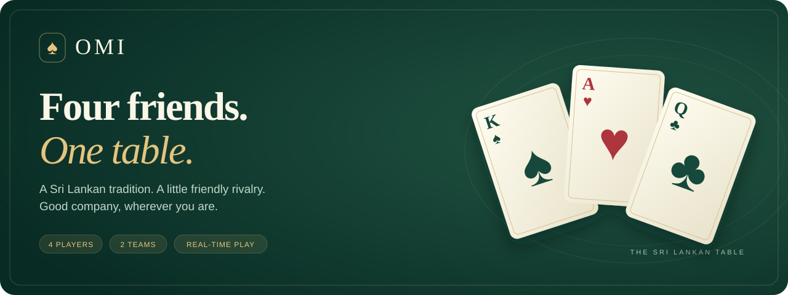
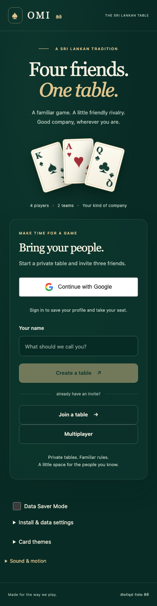
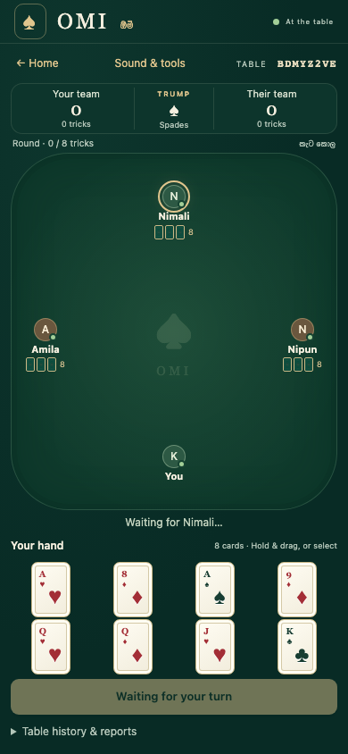
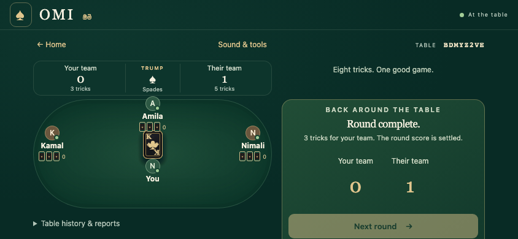
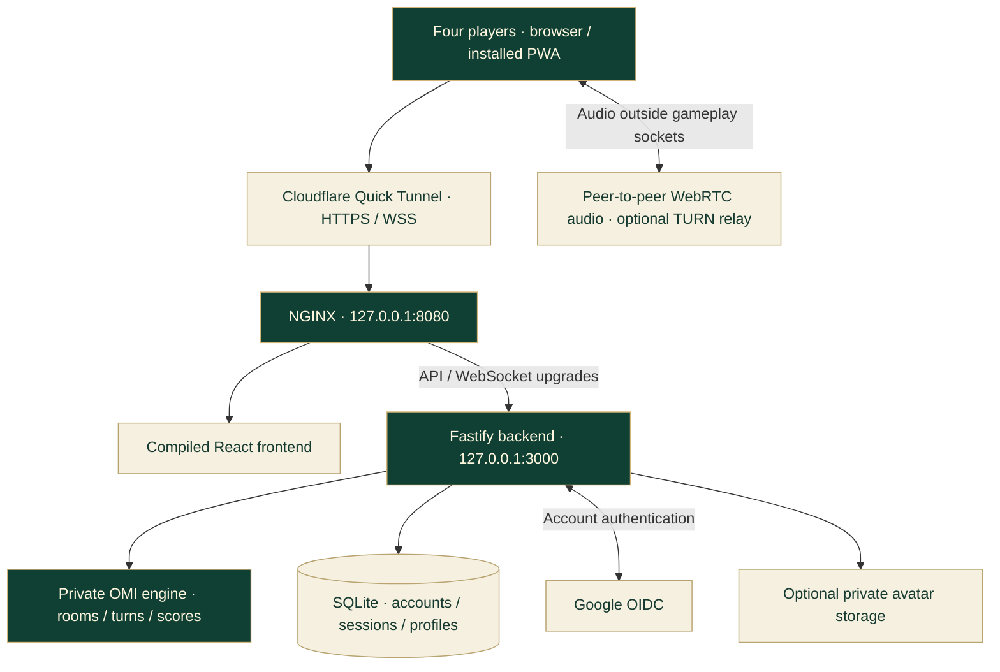

<div align="center">

<a href="#the-game"></a>

**A mobile-first Sri Lankan OMI card game for four friends.**

Private tables · Real-time multiplayer · Google sign-in · Voice & chat

[Explore the game](#the-game) · [See the interface](#see-it-in-action) · [Run locally](#quick-start) · [Play remotely](#remote-testing) · [Documentation](#documentation)

**TypeScript** / **React 19** / **Fastify 5** / **WebSockets** / **SQLite**

</div>

> [!IMPORTANT]
> **Ready for controlled testing, with explicit release limits.** Production startup and the closed Cloudflare maintenance gate have been verified. Real Google login and a four-player Internet session still require interactive verification. Production next-round progression and complete-match rules remain blocked by owner decisions. Avatar storage and Internet voice TURN configuration are also outstanding. See [current readiness](#current-readiness).

## The game

Bring three friends, share a private table, and play in two teams with partners seated opposite each other. OMI brings the familiar Sri Lankan card table to a small screen: emerald felt, warm paper cards, deliberate interactions, and room for a little friendly rivalry.

| At the table                | What OMI provides                                                                                                                                    |
| :-------------------------- | :--------------------------------------------------------------------------------------------------------------------------------------------------- |
| **Four players, two teams** | Four player seats, opposite teammates, ready checks, and host-controlled round start.                                                                |
| **Private invitations**     | Shareable room codes and invite links, plus authenticated matchmaking.                                                                               |
| **Real-time gameplay**      | A server-owned deck, hands, turns, scores, and recipient-specific state updates.                                                                     |
| **Reconnect and resume**    | Restore your authorized seat and private hand while the room and session remain alive.                                                               |
| **Your account**            | Google OIDC sign-in, persistent sessions and editable profiles. Custom avatar uploads require object storage.                                        |
| **Talk at the table**       | Separately authorized voice signaling, room chat, reactions, and opt-in shared music. Remote voice needs suitable ICE/TURN configuration.            |
| **Make it yours**           | Classic and Royal card themes, sound controls, reduced-motion support, and touch-friendly card interactions.                                         |
| **Made for phones**         | Responsive layouts, Data Saver Mode, installable PWA support on compatible browsers, and a static offline fallback. Live games require a connection. |

<details>
<summary><strong>♠ A quick introduction to OMI</strong></summary>

- Exactly **four players**, split into **two teams**; teammates sit opposite each other.
- The playing deck contains **32 cards**: A, K, Q, J, 10, 9, 8, and 7 in each suit.
- The initial dealer is chosen randomly. The player on the dealer's left cuts; cards are dealt counterclockwise.
- Players receive four cards first. The player on the dealer's right chooses **trump — තුරුම්පු** from a suit present in their initial hand.
- Four more cards are dealt to each player. Four played cards form a trick; a round contains eight tricks.
- The server controls the deck, validates actions, and calculates supported results.

OMI's intentional deception and manual accusation rules are distinct from transport/security validation. Some accusation, no-trump, continuation, and scoring policies remain unresolved; this project does not invent missing rules or automatically penalize intentional deception.

Read the [owner-defined rules](docs/OWNER_RULES.md), [engine guide](docs/ENGINE.md), and [open rule decisions](docs/RULE_CLARIFICATIONS.md).

</details>

## See it in action

**Actual application captures from local Playwright fixtures.** Players and room data below are synthetic. Click an image to open the full-size capture; these are screenshots, not a hosted demo or proof of real Google authentication.

<table>
  <tr>
    <th align="center">Bring your people</th>
    <th align="center">Take your seat</th>
  </tr>
  <tr>
    <td align="center" valign="top"><a href="docs/assets/omi-home.png"></a></td>
    <td align="center" valign="top"><a href="docs/assets/omi-table.png"></a></td>
  </tr>
</table>

<details>
<summary><strong>♦ Open the round-results preview</strong></summary>

[](docs/assets/omi-round-results.png)

The capture shows a completed local test round. A visible next-round control does not establish production continuation: production still requires an approved next-dealer policy. See [the remaining-work audit](docs/OMI_REMAINING_WORK_AUDIT.md).

</details>

## Quick start

### 1. Select a compatible Node runtime

Use **Node.js ≥22.23.4 and <23**, as specified in [`.nvmrc`](.nvmrc) and [`package.json`](package.json). An official standard installation is sufficient; no custom Node build is required.

```sh
node --version
npm --version
```

<details>
<summary><strong>Already using nvm?</strong></summary>

From the repository root, install/select the version declared by the project:

```sh
nvm install
nvm use
```

This assumes nvm is already installed. OMI does not install a version manager or modify your global Node installation automatically.

</details>

<details>
<summary><strong>Existing Apple Silicon checkout with the verified local runtime?</strong></summary>

If this distribution already exists on your Mac, select it for this terminal:

```sh
export PATH="$PWD/.remote-testing/tools/node-v22.23.4-darwin-arm64/bin:$PATH"
node --version
```

The directory contains an official Node distribution, not a custom build. It is ignored by Git and will not exist in a fresh clone. The remote-testing launcher prefers a compatible standard Node on PATH and uses this existing distribution only as a fallback. An explicit `OMI_NODE_BINARY=/absolute/path/to/node` takes precedence.

</details>

### 2. Install and build

Run from the repository root:

```sh
npm ci
npm run build
```

The build compiles shared packages before the server and web application. Build once before starting a fresh checkout.

### 3. Configure the backend privately

Create the server environment file **only if it does not already exist**:

```sh
test -e apps/server/.env || cp .env.example apps/server/.env
chmod 600 apps/server/.env
```

For local development, review these settings in that private file:

| Variable               | Local development value or purpose                    |
| :--------------------- | :---------------------------------------------------- |
| `HOST`                 | `127.0.0.1`                                           |
| `PORT`                 | `3000`                                                |
| `NODE_ENV`             | `development`                                         |
| `APP_ORIGIN`           | `http://127.0.0.1:5173` — exact browser origin        |
| `DATABASE_PATH`        | `./data/omi.sqlite`, relative to the server workspace |
| `ALLOW_GUESTS`         | `false` for Google account authentication             |
| `GOOGLE_CLIENT_ID`     | Your Google OAuth Web client ID                       |
| `GOOGLE_CLIENT_SECRET` | Server-only client secret                             |
| `GOOGLE_CALLBACK_URL`  | `http://127.0.0.1:5173/api/auth/google/callback`      |

Configure all three Google variables together and register the exact callback on the matching Google Web client. See [account setup](docs/ACCOUNTS.md). Without Google configuration, account sign-in is unavailable.

> [!TIP]
> For a local gameplay experiment only, explicitly set `ALLOW_GUESTS=true` in your development configuration. This does not test Google authentication. Guest authentication is forbidden in production.

Never commit environment files or put server secrets in `VITE_*` variables. Preserve an existing SQLite database; it contains account and session data.

### 4. Start both processes

**Terminal 1 — backend**

```sh
npm run dev:server
```

**Terminal 2 — frontend**

```sh
npm run dev:web
```

Open **[127.0.0.1:5173](http://127.0.0.1:5173)**. The frontend proxies `/api` to the backend; backend health is available at **[127.0.0.1:3000/health](http://127.0.0.1:3000/health)**.

Use four independent browser profiles or isolated contexts for four players. Tabs sharing the same session cookie represent the same player; reconnecting that player can replace their older connection.

## Remote testing

The remote-testing scripts serve the **compiled production frontend** through loopback-only NGINX and a temporary HTTPS Cloudflare Quick Tunnel. They keep application access closed until you explicitly confirm Google callback registration.

Prerequisites: branch `dev`, compatible Node, npm, Homebrew, NGINX, cloudflared, private Google configuration, and unused loopback ports 3000/8080 (or separately configured ports).

```sh
infra/scripts/start-remote-testing.sh
```

Keep that terminal open. The supervisor:

1. Validates the selected runtime and local configuration.
2. Starts NGINX with a closed maintenance gate.
3. Captures the actual HTTPS Quick Tunnel origin.
4. Builds production assets and applies database migrations.
5. Starts the backend on loopback and checks health.
6. Verifies the public maintenance gate and prints the exact OAuth callback.

In a second terminal, check the running deployment:

```sh
infra/scripts/check-remote-testing.sh
```

Register the **exact printed callback** in the matching Google OAuth Web client. A new Quick Tunnel can have a different hostname. The launcher constructs `APP_ORIGIN` and `GOOGLE_CALLBACK_URL` dynamically; never hardcode an old tunnel URL.

**Only after Google registration is confirmed**, explicitly open application access:

```sh
infra/scripts/start-remote-testing.sh --activate-google-registered
```

Verify actual Google login, refresh persistence, logout, and login again before inviting three friends. Use distinct accounts and begin with a controlled single-round session.

Stop using Ctrl-C in the supervisor, or:

```sh
infra/scripts/stop-remote-testing.sh
```

The supervisor stops only its managed services and preserves application data. Never publish the Vite development server or local identity-provider fixtures.

**Need help?** Start with [remote-testing troubleshooting](docs/REMOTE_TESTING_TROUBLESHOOTING.md), then [Cloudflare setup](docs/CLOUDFLARE_MULTIPLAYER_SETUP.md) and [operations](docs/OPERATIONS.md).

## How it works



The server owns the game. Clients receive public room state and their own private hand, send versioned actions, and resynchronize after interruptions. Per-room serialization and action receipts prevent duplicate execution. Voice signaling is authorized separately; audio does not travel through gameplay WebSockets.

| Data                                          | Where it lives                  | Survives a backend restart?            |
| :-------------------------------------------- | :------------------------------ | :------------------------------------- |
| Accounts, sessions, profile metadata, reports | SQLite                          | Yes, with a persistent database volume |
| Sanitized custom avatars                      | Configured object storage       | Yes, subject to storage configuration  |
| Rooms, current hands, scores, action receipts | Backend memory                  | **No**                                 |
| Display, audio and Data Saver preferences     | Browser storage where available | Normally; users/browsers may clear it  |

## Security model

- **Identity:** Google authorization-code OIDC with PKCE, state, nonce, and token validation; production guest authentication is rejected.
- **Sessions:** opaque credentials, hashed persistence, rotation and revocation; production cookies are Secure, HttpOnly, SameSite=Lax, and use `__Host-` names.
- **Request boundaries:** exact Origin checks, CSRF protection for account mutations, strict inputs, body/frame limits, and rate limits.
- **Game integrity:** authenticated room membership, server-owned seats and turns, private hand projections, replay protection, and version checks.
- **Deployment:** loopback services, controlled proxy forwarding, compiled assets, denied private paths/source maps, and an explicit maintenance gate.
- **Diagnostics:** bounded allowlisted service summaries, private runtime files, and no raw OAuth-response/token logging.

These are implemented controls with local regression coverage, **not a claim of complete security or a production certification**. See the [security review](docs/SECURITY_REVIEW.md), [coverage matrix](docs/SECURITY_COVERAGE_MATRIX.md), and [production readiness assessment](docs/PRODUCTION_SECURITY_READINESS.md).

## Development and verification

Run with the compatible Node runtime selected. Some tests bind local HTTP/WebSocket ports; sandboxed environments must allow loopback listeners.

```sh
npm run build
npm run typecheck
npm run lint
npm test
npm run test:security
npm run test:infra
npm run check:build
```

The infrastructure suite requires a completed build and uses disposable databases for compiled migration, backup, restore, readiness, startup, and shutdown checks.

<details>
<summary><strong>♣ Browser, voice, PWA and load-test commands</strong></summary>

Install browser binaries once:

```sh
npx playwright install chromium firefox
```

| Command                     | Coverage                                                               |
| :-------------------------- | :--------------------------------------------------------------------- |
| `npm run test:e2e`          | Local development browser fixtures                                     |
| `npm run test:e2e:nginx`    | Compiled frontend, NGINX, gameplay, profiles, mobile layouts and sound |
| `npm run test:remaining`    | Navigation and four-account matchmaking                                |
| `npm run test:voice`        | WebRTC voice with synthetic browser audio                              |
| `npm run test:voice:relay`  | Relay-specific voice; requires local coturn prerequisites              |
| `npm run test:social`       | Chat, reactions and shared music                                       |
| `npm run test:themes`       | Card theme behavior                                                    |
| `npm run test:pwa`          | Install/offline/cache/privacy behavior                                 |
| `npm run test:load -- 8 30` | Private loopback multi-room benchmark                                  |
| `npm run format:check`      | Repository formatting                                                  |

Run browser suites sequentially when their fixture ports overlap. Read [testing](docs/TESTING.md), [voice](docs/VOICE.md), [PWA](docs/PWA.md), and the [load-test report](docs/LOAD_TEST_REPORT.md) for prerequisites and limits. Local OIDC fixtures never certify real Google login.

</details>

<details>
<summary><strong>♥ Latest recorded startup-repair verification</strong></summary>

Evidence recorded on **2026-10-27**, not a live CI badge:

| Check                                               | Recorded result                                            |
| :-------------------------------------------------- | :--------------------------------------------------------- |
| Production build, typecheck, lint and bundle checks | Passed                                                     |
| Unit/integration suite                              | 205 passed                                                 |
| Focused security suite                              | 90 passed; overlaps the full suite                         |
| Infrastructure suite                                | 13 passed                                                  |
| Chromium/Firefox NGINX browser suite                | 26 passed                                                  |
| Production backend and local NGINX                  | Healthy; loopback listeners verified                       |
| Real Cloudflare maintenance gate                    | Verified externally; application access stayed closed      |
| SQLite preservation                                 | Integrity passed; existing user records unchanged          |
| Actual production readiness checker                 | Exit 1: avatar storage and remote-voice TURN checks failed |

The temporary deployment was stopped after verification. These results describe the recorded repair; rerun checks for your checkout and deployment environment. Details and earlier feature-suite evidence are in [troubleshooting](docs/REMOTE_TESTING_TROUBLESHOOTING.md).

</details>

## Current readiness

| Area                                             | Status and remaining work                                                                |
| :----------------------------------------------- | :--------------------------------------------------------------------------------------- |
| Local four-player round                          | Implemented and tested with isolated clients                                             |
| Production startup and HTTPS maintenance gate    | Verified; runtime/security checks remain enforced                                        |
| Real Google login and Internet multiplayer       | **Manual verification required** after registering the current callback                  |
| Next round and complete match                    | **Blocked by rule decisions**; no approved ordinary next-dealer or terminal match policy |
| Accusation/no-trump and unresolved scoring paths | Explicit rule gates; see owner decisions                                                 |
| Internet voice                                   | Local peer audio tested; current deployment lacks STUN/TURN configuration                |
| Custom avatar uploads                            | Implemented; disabled until private object storage is configured                         |
| Offline behavior                                 | Static fallback only; no offline multiplayer or queued game actions                      |
| Server restarts                                  | Persistent accounts remain; active in-memory games end                                   |

Do not treat passing local fixtures as proof of remote login, physical-device audio, or a complete multi-round match. See the [remaining-work audit](docs/OMI_REMAINING_WORK_AUDIT.md) and [rule clarifications](docs/RULE_CLARIFICATIONS.md).

## Repository map

```text
OMI/
├── apps/
│   ├── web/              React UI, cards, accounts, voice, social and PWA
│   └── server/           Fastify, authentication, rooms and SQLite persistence
├── packages/
│   ├── shared/           Public wire contracts and shared types
│   └── game-engine/      Server-private OMI rules and deterministic transitions
├── infra/
│   ├── nginx/            Production reverse-proxy template
│   ├── scripts/          Gated remote-testing supervisor and operations
│   └── tests/            Infrastructure fixtures and load harness
└── docs/                 Architecture, setup, security, rules and verification
```

## Documentation

| I want to…                         | Read                                                                                                                    |
| :--------------------------------- | :---------------------------------------------------------------------------------------------------------------------- |
| Start or repair remote testing     | [Troubleshooting](docs/REMOTE_TESTING_TROUBLESHOOTING.md) · [Cloudflare setup](docs/CLOUDFLARE_MULTIPLAYER_SETUP.md)    |
| Understand the system              | [Architecture](docs/ARCHITECTURE.md) · [Multiplayer protocol](docs/MULTIPLAYER.md) · [Game states](docs/GAME_STATES.md) |
| Configure accounts and avatars     | [Accounts](docs/ACCOUNTS.md)                                                                                            |
| Set up audio, chat and music       | [Voice](docs/VOICE.md) · [Social](docs/SOCIAL.md)                                                                       |
| Explore the interface              | [UI](docs/UI.md) · [Card interactions](docs/CARD_INTERACTIONS.md) · [Themes](docs/THEMES.md) · [PWA](docs/PWA.md)       |
| Review OMI rules                   | [Owner rules](docs/OWNER_RULES.md) · [Engine](docs/ENGINE.md) · [Open decisions](docs/RULE_CLARIFICATIONS.md)           |
| Review security and release limits | [Security](docs/SECURITY.md) · [Review](docs/SECURITY_REVIEW.md) · [Readiness](docs/PRODUCTION_SECURITY_READINESS.md)   |
| Run checks or operate the backend  | [Testing](docs/TESTING.md) · [Operations](docs/OPERATIONS.md) · [Deployment](docs/DEPLOYMENT.md)                        |
| Find known product gaps            | [Remaining-work audit](docs/OMI_REMAINING_WORK_AUDIT.md)                                                                |

<div align="center">

**Made for the way we play.**

[Back to the table ↑](#the-game)

</div>
