# Game states

**Implemented in Stage B in the standalone engine. No network or UI integration.**

```mermaid
stateDiagram-v2
    [*] --> awaitingCut: trusted initial dealer and shuffled deck
    awaitingCut --> awaitingTrump: dealer's left cuts; four cards each
    awaitingTrump --> playing: dealer's right selects a suit in first four; four more each
    playing --> playing: card play or completed trick
    playing --> complete: eighth trick completes
    playing --> cancelled: manual no-trump report verified under explicit policy
    cancelled --> awaitingCut: reshuffle and explicit replacement dealer; new round ID
```

API phase strings are `awaiting-cut`, `awaiting-trump`, `playing`, `complete`, `cancelled`.

- `createRound`: copies and validates a complete 32-card deck. It does not select/shuffle implicitly.
- `cutAndDeal`: requires the dealer's left and a nonempty two-pile cut; deals four to each, right first, counterclockwise, dealer last.
- `selectTrump`: requires selector and a suit in their first four; deals remaining cards and sets selector's turn.
- `playCard`: checks phase, turn and ownership. A follow-suit violation is accepted and recorded only in private evidence. Four cards resolve a trick; the winner leads next. Eight tricks complete the round.
- `settleRound`: accepts only a completed eight-trick round. Scores 1/2/3 as confirmed, or records one draw carry. Repeated draws and Kapothi with carry return unresolved without mutating the ledger.
- `accuse`: explicit manual entry point, independent of ordinary play. No default accusation window. A verified, eligible report transfers three points exactly once per evidence item in that ledger.
- `reportNoTrump`: requires the opposing team and an explicit report timing/basis policy. Confirmed reports cancel the round. There is no automatic report.
- `restartCancelledRound`: requires a confirmed cancellation, explicitly chosen different dealer, new round ID and a fresh caller-shuffled deck. It returns to interactive cutting before dealing.

Unresolved results preserve all inputs and apply no guessed outcome. Completed/cancelled rounds cannot accept card plays. Normal inter-round dealer rotation, game-winning threshold and physical scoring-counter inventories are outside confirmed rules and are not implemented.
