# Game states

## Current Stage H status

Stage H adds no engine or server state. Offline navigation displays a generic static fallback; live tabs retain existing disconnected/reconnect handling and server-only actions. No hands, account data, commands or game snapshots are persisted by the service worker. Data Saver is visual/audio preference only. Updates wait for clients to close; backend restart still destroys rooms.

## Current Stage G status

Social chat/reactions have their own ephemeral connection sequence and do not advance game versions. Shared music has an independent host-controlled revision/timeline. Local audio, profanity preferences and incoming blocks are device/table controls; reports never modify scores or adjudicate cheating. Disconnect pauses local audio and revokes social access while preserving current room social history until room expiry. Backend restart still ends in-memory game/social state. No owner game rule changed.

## Current Stage F status

Voice is an independent opt-in lifecycle: off → joining → connected, with bounded reconnecting/error paths and explicit leave. It never increments game versions, adds turns or changes scores. Voice-local action sequence/call IDs are distinct from game state versions. Leaving voice preserves game membership; game socket loss/logout closes voice and microphone tracks. No OMI engine phase or owner rule changed.

## Current Stage E status

Stage E adds account bootstrap, login, profile editing and logout outside the game engine. Logout changes connection presence and revokes the session; it does not invent forfeits or remove reserved room seats. Returning account identity can resynchronize a live room. No engine states, scoring rules or unresolved rule gates were changed.

**Engine states implemented in Stage B; integrated with server-authoritative room actions in Stage C. Stage D now renders these public phases.**

```mermaid
stateDiagram-v2
    [*] --> awaitingCut: trusted initial dealer and shuffled deck
    awaitingCut --> awaitingTrump: dealer's left cuts; four cards each
    awaitingTrump --> playing: dealer's right selects a suit in first four; four more each
    playing --> playing: card play or completed trick
    playing --> complete: eighth trick completes
    playing --> cancelled: manual no-trump report verified under explicit policy
    cancelled --> awaitingCut: reshuffle and explicit replacement dealer; new round ID
```

API phase strings are `awaiting-cut`, `awaiting-trump`, `playing`, `complete`, `cancelled`.

- `createRound`: copies and validates a complete 32-card deck. It does not select/shuffle implicitly.
- `cutAndDeal`: requires the dealer's left and a nonempty two-pile cut; deals four to each, right first, counterclockwise, dealer last.
- `selectTrump`: requires selector and a suit in their first four; deals remaining cards and sets selector's turn.
- `playCard`: checks phase, turn and ownership. A follow-suit violation is accepted and recorded only in private evidence. Four cards resolve a trick; the winner leads next. Eight tricks complete the round.
- `settleRound`: accepts only a completed eight-trick round. Scores 1/2/3 as confirmed, or records one draw carry. Repeated draws and Kapothi with carry return unresolved without mutating the ledger.
- `accuse`: explicit manual entry point, independent of ordinary play. No default accusation window. A verified, eligible report transfers three points exactly once per evidence item in that ledger.
- `reportNoTrump`: requires the opposing team and an explicit report timing/basis policy. Confirmed reports cancel the round. There is no automatic report.
- `restartCancelledRound`: requires a confirmed cancellation, explicitly chosen different dealer, new round ID and a fresh caller-shuffled deck. It returns to interactive cutting before dealing.

Unresolved results preserve all inputs and apply no guessed outcome. Completed/cancelled rounds cannot accept card plays. Normal inter-round dealer rotation, game-winning threshold and physical scoring-counter inventories are outside confirmed rules and are not implemented.

## Stage C room lifecycle

A room begins as a version-0 lobby with its host at seat 0. Authenticated joins claim seats 1–3 and increment the version. Presence and ready commands also increment it. Host start requires exactly four ready connected members; it creates an engine round awaiting cut. The engine controls all dealing, turns and final trick resolution. Final card play settles confirmed scoring exactly once and emits the public result.

Ordinary plays publish compact deltas; authenticated sync and reconnect use private whitelist snapshots. Direct same-identity socket replacement preserves state/version; actual offline/online transitions advance the version. A disconnect never changes scores, hands, teams or the current turn.

Cancellation/restart and next-round advancement are gated by trusted owner-confirmed policies. Normal dealer rotation is still unspecified, so the default server completes one round and refuses to invent the next dealer. Explicit test-only callbacks verify restart and continuation mechanics; none is activated in the default application.

See MULTIPLAYER.md for action schemas, version-gap handling, capacity and ephemeral lifecycle limits.

## Stage D browser states

Home/join → pending HTTP entry → room connecting → lobby snapshot → ready/start → cut/trump/playing/complete views. Every gameplay transition remains server-authoritative. Card selection is local UI only; Play sends an action and the card remains until its confirmed public event. Gaps switch controls to recovery until a snapshot arrives. A lost ack retries the identical action rather than advancing or recreating a card play.

Offline, reconnecting, replaced-tab and expired-session states disable gameplay and expose appropriate recovery/home controls. Cached metadata can resume the same table, but does not contain a saved engine state or hand. No client transition chooses a new dealer, auto-accuses or scores an unconfirmed combination.
